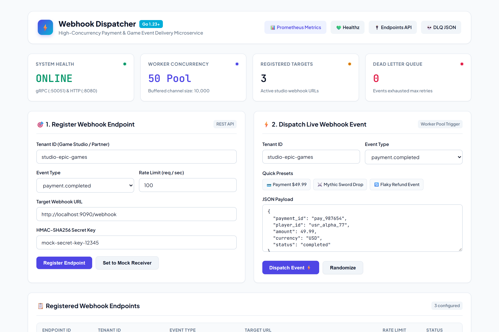
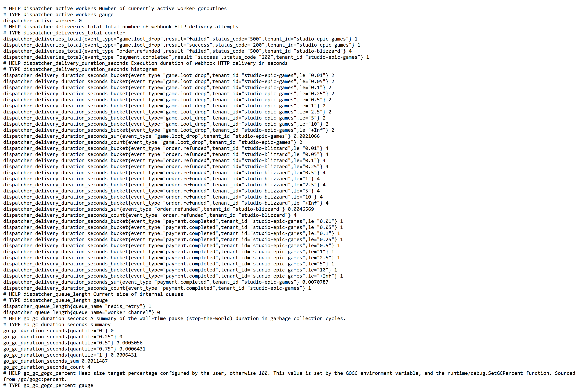
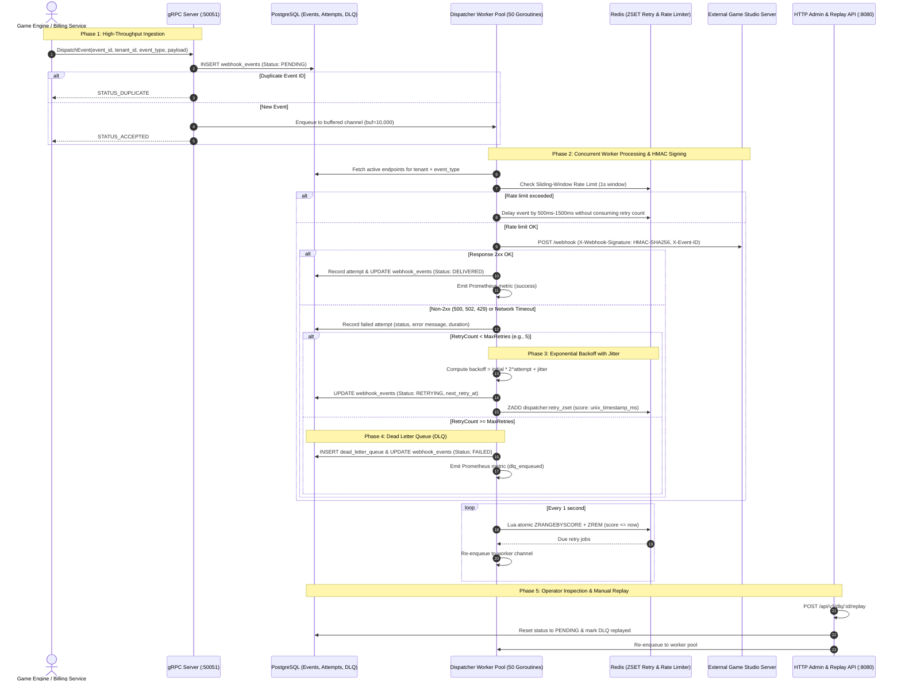

# High-Throughput Webhook & Notification Dispatcher (Go)

[](https://golang.org)
[](https://grpc.io)
[](https://github.com/jackc/pgx)
[](https://redis.io)
[](https://echo.labstack.com)
[](https://prometheus.io)

A production-grade, distributed Go microservice engineered to reliably deliver high-volume, real-time payment transactions and in-game notifications to external game studios and partner platforms.

---

## 📸 Screenshots & Interactive Dashboard

The service includes an interactive, responsive Web UI Dashboard for real-time monitoring, endpoint configuration, event simulation, and 1-click Dead Letter Queue (DLQ) replaying.

### 1. Webhook Management & Live Dispatch Dashboard


### 2. Real-Time Prometheus Metrics Exposure


---

## 🚀 Key Architectural Highlights

- **Language & Runtime:** Built with **Go (1.23+)** taking full advantage of Go's native concurrency primitives: goroutines, buffered channels, sync primitives, and atomic memory operations.
- **Internal API:** Ultra-low latency **gRPC** server with Protocol Buffers (`google.golang.org/grpc`, `google.golang.org/protobuf`) for high-throughput event ingestion.
- **High-Concurrency Worker Pool:** Bounded worker pool (configurable, e.g. 50 concurrent worker goroutines) reading from buffered channels with tuned HTTP/2 pooled transports, strict connection timeouts (5s connect, 10s total), and graceful draining on shutdown.
- **Cryptographic Security:** Payload integrity guaranteed with **HMAC-SHA256** signatures (`X-Webhook-Signature: sha256=<hex>`), verified using constant-time comparison (`crypto/subtle.ConstantTimeCompare`) against timing side-channel attacks.
- **Fault-Tolerant Exponential Backoff with Jitter:** Non-2xx HTTP responses or timeouts trigger exponential backoff with full jitter to avoid thundering herd surges.
- **Delayed Retry Scheduling with Redis Sorted Sets:** Retries are stored in Redis ZSETs (`ZADD`) with their next execution millisecond timestamp as the score. Atomic Lua scripts claim due jobs across distributed replicas.
- **Dead Letter Queue (DLQ) & Manual Replay:** Events failing all retry attempts are marked as `FAILED` and recorded in the PostgreSQL `dead_letter_queue` table, with a manual replay REST endpoint (`POST /api/v1/dlq/:id/replay`).
- **Observability:** Prometheus metrics (`/metrics`) and structured JSON logging (`log/slog`).
- **Resilient Storage Architecture:** Seamlessly connects to PostgreSQL + Redis in production or Docker, and gracefully defaults to in-memory storage for immediate local development.

---

## 📐 Architecture & Lifecycle Sequence



---

## 📂 Project Directory Structure

```text
├── api/
│   └── proto/dispatcher/v1/
│       ├── dispatcher.proto           # Protobuf v3 contract
│       ├── dispatcher.pb.go           # Generated Go protobuf types
│       └── dispatcher_grpc.pb.go      # Generated gRPC client/server stubs
├── cmd/
│   ├── server/
│   │   └── main.go                    # Microservice entrypoint (gRPC + HTTP + Worker pool)
│   ├── mockreceiver/
│   │   └── main.go                    # Flaky game studio mock receiver for local testing
│   └── demo/
│       └── main.go                    # Automated end-to-end verification client
├── docs/
│   └── screenshots/                   # High-resolution dashboard & metrics screenshots
│       ├── dashboard_overview.png
│       └── metrics_prometheus.png
├── internal/
│   ├── config/
│   │   └── config.go                  # 12-factor environment configuration
│   ├── domain/
│   │   └── models.go                  # WebhookEndpoint, EventMessage, DeliveryAttempt, DLQItem
│   ├── metrics/
│   │   └── metrics.go                 # Prometheus counters, gauges, and latency histograms
│   ├── queue/
│   │   ├── memory/                    # In-memory delay queue fallback
│   │   └── redis/                     # Redis ZSET delay scheduler & sliding-window rate limiter
│   ├── repository/
│   │   ├── memory/                    # In-memory storage fallback for local dev
│   │   └── postgres/                  # pgx/v5 connection pool, transactions, schema migrations
│   ├── security/
│   │   ├── hmac.go                    # HMAC-SHA256 signature generator & constant-time verifier
│   │   └── hmac_test.go               # Security unit tests
│   ├── transport/
│   │   ├── grpc/
│   │   │   └── server.go              # gRPC DispatchEvent implementation with interceptors
│   │   └── http/
│   │       ├── dashboard.html         # Embedded modern light-mode management UI
│   │       └── server.go              # Echo REST endpoints: management, monitoring, DLQ replay
│   └── worker/
│       ├── backoff.go                 # Exponential backoff calculator with full jitter
│       ├── backoff_test.go            # Backoff unit tests
│       ├── pool.go                    # Bounded worker pool, connection-pooled HTTP client
│       └── pool_test.go               # Channel draining and graceful shutdown unit tests
├── migrations/
│   ├── 000001_init_schema.up.sql      # PostgreSQL schema migration
│   ├── 000001_init_schema.down.sql    # Rollback migration
│   └── migrations.go                  # Embedded SQL migration assets
├── docker-compose.yml                 # PostgreSQL, Redis, App, Mock Receiver, Prometheus
├── Dockerfile                         # Production multi-stage Alpine build
├── Makefile                           # Development tasks (proto, build, test, up, demo)
├── prometheus.yml                     # Prometheus scrape configuration
└── README.md
```

---

## ⚡ Quick Start

### Option 1: Run Locally (Standalone Mode)
The service features an automatic in-memory fallback, allowing you to run it directly without installing PostgreSQL or Redis:

```bash
# Terminal 1: Run the Mock Game Studio Receiver
go run ./cmd/mockreceiver -port 9090 -secret mock-secret-key-12345 -fail-rate 0.4

# Terminal 2: Run the Webhook Dispatcher Microservice
go run ./cmd/server
```

Now open **[http://localhost:8080](http://localhost:8080)** in your browser!

### Option 2: Run with Docker Compose
To run the full distributed production stack with PostgreSQL, Redis, Prometheus, and the Go application:

```bash
# 1. Start all containers
docker compose up -d --build

# 2. View application logs
docker compose logs -f app

# 3. In another terminal, run the automated verification demo
go run ./cmd/demo -scenario all

# 4. Stop containers
docker compose down -v
```

### Port Mappings
| Service | Port | Description |
|---|---|---|
| Webhook Dispatcher (HTTP) | `:8080` | Web UI Dashboard, Admin REST API & `/metrics` |
| Webhook Dispatcher (gRPC) | `:50051` | High-throughput ingestion RPC |
| Mock Game Studio Receiver | `:9090` | Flaky webhook receiver simulator |
| Prometheus UI | `:9091` | Metrics dashboard & query browser |
| PostgreSQL | `:5432` | Relational event log & DLQ database |
| Redis | `:6379` | Delay queue & sliding-window rate limiter |

---

## 📡 REST Management API Reference

### 1. Register Webhook Endpoint
```bash
curl -X POST http://localhost:8080/api/v1/endpoints \
  -H "Content-Type: application/json" \
  -d '{
    "tenant_id": "studio-epic-games",
    "event_type": "payment.completed",
    "target_url": "http://localhost:9090/webhook",
    "secret_key": "mock-secret-key-12345",
    "rate_limit_per_sec": 100
  }'
```

### 2. Dispatch Live Event via HTTP (Manual / Web Trigger)
```bash
curl -X POST http://localhost:8080/api/v1/dispatch \
  -H "Content-Type: application/json" \
  -d '{
    "tenant_id": "studio-epic-games",
    "event_type": "payment.completed",
    "payload": "{\"payment_id\":\"pay_101\",\"amount\":49.99,\"currency\":\"USD\"}"
  }'
```

### 3. List Registered Endpoints
```bash
curl http://localhost:8080/api/v1/endpoints?tenant_id=studio-epic-games
```

### 4. Inspect Dead Letter Queue (DLQ)
```bash
curl http://localhost:8080/api/v1/dlq
```

### 5. Manually Replay DLQ Item
```bash
curl -X POST http://localhost:8080/api/v1/dlq/evt-web-12345/replay
```

### 6. Health & Readiness Check
```bash
curl http://localhost:8080/healthz
```

---

## 🔒 Webhook HMAC Signature Verification

External game studios should verify incoming HTTP POST requests using the `X-Webhook-Signature` header:

```go
package main

import (
	"crypto/hmac"
	"crypto/sha256"
	"crypto/subtle"
	"encoding/hex"
	"strings"
)

// VerifyWebhook validates that the signature matches the HMAC-SHA256 digest of payload.
func VerifyWebhook(secret string, payload []byte, signatureHeader string) bool {
	cleanSig := strings.TrimPrefix(signatureHeader, "sha256=")

	mac := hmac.New(sha256.New, []byte(secret))
	mac.Write(payload)
	expectedHex := hex.EncodeToString(mac.Sum(nil))

	sigBytes, err1 := hex.DecodeString(cleanSig)
	expBytes, err2 := hex.DecodeString(expectedHex)
	if err1 != nil || err2 != nil {
		return false
	}

	return subtle.ConstantTimeCompare(sigBytes, expBytes) == 1
}
```

---

## 🧪 Unit Testing

Run the full unit test suite covering cryptographic signing, exponential backoff with full jitter and bounds, and worker pool channel draining:

```bash
go test -v ./...
```

To regenerate Protobuf Go stubs from `.proto` definition:
```bash
make proto
```

---

## 📄 License
MIT License. Built with ❤️ in Go for high-concurrency event-driven systems.
